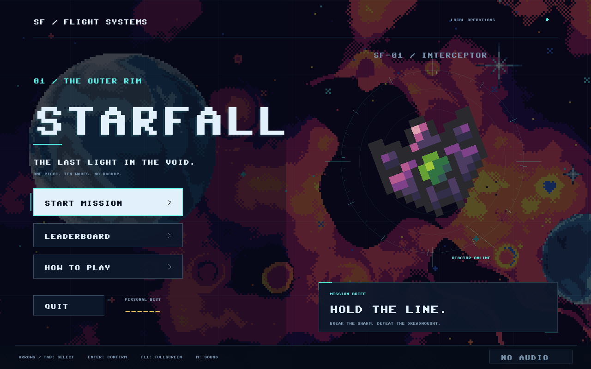

# STARFALL

A single-player space arena shooter in **C++17 and SDL2**. Fly freely, aim with the mouse, survive ten waves, and clear the Dreadnought's final wave. Welcome, pause, flight manual, victory/defeat, pilot-name entry, and a persistent local top-ten leaderboard complete the game flow.



| Audience | Start here |
| --- | --- |
| User: launch, configure, upgrade, or recover | [User guide](docs/USER.md), or the short [setup walkthrough](SETUP.md) |
| Player: controls, hostiles, combat, scoring, and saving | [Player guide](docs/PLAYER.md) |
| Developer: build, test, understand ownership, or change code | [Developer guide](docs/DEVELOPER.md) and [architecture diagrams](docs/ARCHITECTURE.md) |
| Lecturer or presenter: design, C++ examples, and repeatable demo | [Lecturer walkthrough](docs/LECTURER.md) |

Extract **Starfall-Windows-x64.zip** and double-click **PLAY.bat** or **Starfall.exe** inside it. Keep all four supplied SDL DLLs and the complete `resources` folder beside the executable. Playing this portable build needs no compiler or dependency download. The separate **Starfall-Source.zip** contains source and pinned rebuild inputs; run **BUILD.bat** there before playing. In the original workspace, the source-folder **PLAY.bat** opens the generated `dist` package, building it if absent. Exact build/package commands belong to the developer guide.

Resources load relative to the executable, while scores stay in the current Windows user's save folder. Upgrading preserves the existing `STARFALL_SCORES_V1` leaderboard without migration. See [save and upgrade guidance](docs/SAVES.md) for backups, custom directories, and retrying failed saves.

## Understanding the folders

For playing, double-click the root **PLAY.bat**. For editing the game, start in **src/**. For sending someone a playable copy, use **releases/Starfall-Windows-x64.zip**.

| Folder | What it contains | Do I need to keep it? |
| --- | --- | --- |
| `src/` | The game's C++ code, divided by responsibility (see below). | Yes, to develop or rebuild. |
| `resources/` | Original input images, font, shooting sound, and their notice. The build copies these into the playable folder. | Yes, to rebuild. |
| `third_party/` | Pinned SDL libraries, dependency source, and license notices. These are build inputs, even though some are already compiled DLLs. | Yes, to rebuild without downloading dependencies. |
| `tests/` | Gameplay, score-saving, and application-flow checks, plus fictional test scores. | Yes, to verify changes. |
| `scripts/` | Build, packaging, and package-verification tools. | Yes, to build and package. |
| `docs/` | Player/developer guides, architecture diagrams, screenshots, and validation records. | Keep for understanding and presenting the project. |
| `.scratch/` | The approved overhaul spec, twelve tickets, and review history. Despite its name, it contains project records. | Keep for the project history. |
| `dist/` | One unpacked, ready-to-play copy: executable, four SDL DLLs, resources, and player documentation. | Keep for immediate play. It can be recreated with `BUILD.bat`. |
| `releases/` | Packaged delivery files described below. | Keep the downloads you want to share or restore. They are not required to build. |
| `build/` | Compiler output and development/verification files. This workspace also has an important Git-checkout exception described below. | Generated compiler output is disposable; keep the checkout and retained evidence. |

The source folders follow the game's responsibilities:

```text
src/
  main.cpp       Program entry point and command-line options
  app/           Window, input, menus, and coordination
  simulation/    Game rules, movement, collisions, and waves
  presentation/  Drawing, textures, fonts, and backgrounds
  audio/         Sound playback and mute/warning handling
  persistence/   Leaderboard loading and safe saving
  platform/      Executable-relative resource paths
```

**Why both `build`, `dist`, and `releases`?** They are three stages of the same process:

```text
Source + resources + third_party
             | BUILD.bat
             v
build/  compiler work files and test programs
             | install the files needed for playing
             v
dist/   runnable game folder
             | package a verified build
             v
releases/Starfall-Windows-x64.zip   portable download
```

Compiler work files can be large, so they are kept out of the playable copy. The ZIP makes the complete playable folder easy to send; you do not need both the ZIP and its extracted copy just to play. Normal builds recreate `dist/`; release packaging uses a fresh staging folder to avoid including leftover files. These generated folders are ignored by Git.

The retained release files have different purposes:

- **Starfall-Windows-x64.zip**: the ready-to-play Windows game. This is the usual file to send to a player.
- **Starfall-Source.zip**: source, resources, and dependency inputs for rebuilding. It needs a compiler.
- **Starfall-History.bundle**: a Git backup containing commits and branches, for restoring development history.
- **final-msvc/**: an alternate portable build made with Microsoft's compiler. Players only need one portable build; this copy retains evidence that both compilers worked.
- **`.sha256` files**: checksums for checking that each archive is unchanged. **DELIVERY.json** records the delivered revision and verification results.

**Special case in this workspace:** `build/integration-repository/` is a second source checkout on `integration/starfall-overhaul`. It holds the completed overhaul's writable Git history because the original root `.git` was read-only. Use this checkout for commits; the top-level source is a matching working copy. Do not delete this directory as if it were compiler output. `build/release-verification/` holds test logs, reports, screenshots, disposable test copies, and the pre-overhaul backup.

### What can be cleaned up?

The extra folders were created for separate compiler builds, incremental development, and testing extracted packages. They are not all needed for everyday work. Cleanup was requested, but this session's automatic approval policy blocked deletion, so these folders are still present:

- In `build/`, old compiler folders (`gcc/`, `msvc/`, `integration-gcc/`), staging folders, `workspaces/`, `worktrees/`, research copies, and earlier QA copies can be removed when no build is running. Keep `integration-repository/` and the verification evidence you want to retain. The checkout's own `build/` subfolder is also disposable compiler output.
- Inside `build/release-verification/`, compiler trees, extracted packages, and restored source/history copies can be regenerated. Keep the top-level reports, `logs/`, `captures/`, `final-captures/`, and `pre-overhaul/` if you want the test evidence and original backup. Historical validation documents will still name the old paths after cleanup.

Removing generated compiler files means the next build takes longer; removing `dist/` means rebuilding or extracting the portable ZIP before playing. Do not remove `resources/` or `third_party/` as a cleanup step: those are required inputs.

Player scores are stored in the current Windows user's save folder, outside `build/`, `dist/`, and `releases/`. See [SAVES.md](docs/SAVES.md) before backing up or moving scores.

The simulation owns its mutable state and exposes a const view. It advances in fixed 1/120-second steps and checks the whole path of each projectile. Presentation uses packaged ship/projectile atlases, imported hull art, four tiled background layers, and a pixel font. A single SDL2_mixer path plays the reference shooting clip and original non-shot effects. The [source map](docs/DEVELOPER.md#source-map-and-ownership) and [combat mappings](docs/COMBAT.md) explain these choices.

Windows x64 GCC and MSVC builds pass both approved test groupings. Current evidence, historical results, and the remaining manual/release checks are distinguished in [validation](docs/VALIDATION.md). Linux/macOS are not validated release targets.

