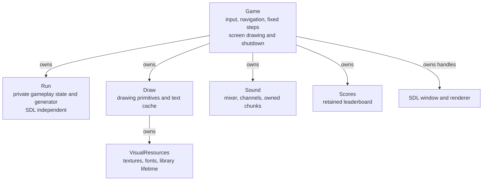
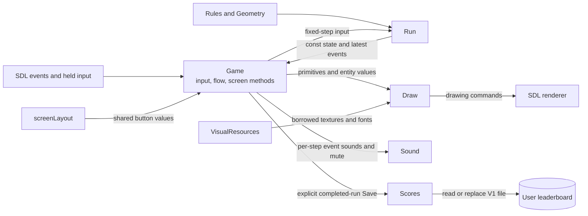

# Starfall architecture

These diagrams describe the implemented source, verified for the lecturer walkthrough on 2026-10-24. Gameplay, screen flow, all combat artwork, hull/HUD, resources, audio, and score compatibility are implemented. Final portable-release validation remains a separate delivery step. See the [developer guide](DEVELOPER.md), [lecturer walkthrough](LECTURER.md), and [domain vocabulary](../GLOSSARY.md).

## Ownership and data flow

The first diagram shows ownership. `Screens.cpp` contains Game's drawing methods, not a separate screen object. `screenLayout` is a free function that supplies Game's button values before input and drawing.



Game owns Run by value and Draw/Sound/Scores through `std::unique_ptr`. Its screen methods observe Run's const view and pass drawing values to Draw. Run cannot call SDL, save scores, or navigate screens. Scores has no gameplay or resource-path dependency. Sound's optional device failure is reported to Game without stopping play.

The next diagram shows calls and data, without transferring ownership. Rules/Geometry are SDL-independent inputs to Run. VisualResources supplies borrowed handles to Draw; Sound and Scores return status to Game as described below.



The window and renderer handles belong to Game. Draw owns its bounded text-texture cache and VisualResources. Returned texture/font pointers are borrowed; they do not transfer ownership. VisualResources destroys fonts/textures before its library guard quits TTF/image. Sound stops channels before releasing chunks and closing mixer/audio. Game resets drawing/audio before destroying its renderer/window and calling SDL_Quit. This order also handles partially completed initialization.

`resourceDirectory()` resolves the executable base directory plus `resources/reference`. Independently, Game selects SDL's current-user preference path or `--data-dir` for Scores. Replacing a portable game folder therefore does not replace the normal user leaderboard.

## One frame

This sequence follows `Game::execute`, `event`, `input`, and `advance`. UI animation time continues while paused; elapsed Run time does not. Input is sampled once for a rendered frame, then reused for its fixed steps.

```mermaid
sequenceDiagram
    participant SDL as SDL platform
    participant Game as Game
    participant Layout as screenLayout
    participant Run as Run
    participant Sound as Sound
    participant Scores as Scores
    participant Draw as Draw

    Game->>SDL: Measure frame delta
    Note over Game: Advance UI time with bounded delta
    loop Drain queued events
        SDL-->>Game: Next window, keyboard, or mouse event
        Game->>Layout: Refresh current button values
        Layout-->>Game: Logical rectangles and actions
        Note over Game: Dispatch input; a transition refreshes layout immediately
        opt Explicit Save on completed, unsubmitted Run
            Game->>Scores: Submit completed result
            Scores-->>Game: Rank, outside top ten, or retryable error
        end
    end
    Game->>SDL: Sample held keys and raw mouse
    Note over Game: Convert raw mouse once; add camera for world aim
    alt Playing
        Note over Game: Accumulate min(delta, 0.1 seconds)
        loop While accumulator contains a 1/120-second step
            Game->>Run: update(fixedStep, input)
            Run-->>Game: Const state and latest events
            Game->>Sound: Play each step's events
            opt Victory or defeat
                Note over Game,Layout: Enter End, reset accumulator, refresh layout, stop stepping
            end
        end
    else Any other screen
        Note over Game,Run: Skip Run advancement
    end
    Game->>Layout: Refresh layout for drawing
    Layout-->>Game: Same rectangles used by input
    Game->>Draw: Draw current screen and observed values
    Draw->>SDL: Drawing commands
    Game->>SDL: RenderPresent, then Delay(1)
```

Queued mouse events already use SDL logical coordinates because Game sets a 1280x800 logical renderer. Only the raw `SDL_GetMouseState` sample requires `SDL_RenderWindowToLogical`. Converting an event twice would break click alignment after resize. Layout exists before the first render, so multiple queued navigation actions work without drawing between them.

Run clears its event list for each update. Game consumes it inside the fixed-step loop, preserving feedback when several updates precede one display frame. Result transitions stop the loop; menus and focus-loss pause do not advance timers, waves, or damage.

## Where a change belongs

| Change | Primary source | Verification |
| --- | --- | --- |
| Movement, collision, damage, waves, scoring | [Run](../src/simulation/Run.cpp), [Rules](../src/simulation/Rules.hpp) | Focused checks and full campaign |
| Transitions, focus, names, shared controls | [Game](../src/app/Game.cpp), [ScreenLayout](../src/app/ScreenLayout.cpp) | Application input/navigation scenarios |
| Screen composition and HUD | [Screens](../src/app/Screens.cpp) | Current captures and input alignment |
| Sprites, hull clipping, background, fonts | [Draw](../src/presentation/Draw.cpp), [VisualResources](../src/presentation/VisualResources.cpp) | Real-resource application captures; [mapping notes](COMBAT.md) |
| Clips, mute, missing-device recovery | [Sound](../src/audio/Sound.cpp) | Audio scenarios; separate audible check |
| Names, ranking, format, safe writes | [Scores](../src/persistence/Scores.cpp) | Persistence and save/reopen scenarios |
| Dependencies, staging, install inputs | [CMake](../CMakeLists.txt), [wrapper](../scripts/Build.ps1) | Clean builds/install; final extracted-package validation |

The approved test groupings remain application flow and focused gameplay/persistence. Controlled setup and scenario scripts live in [tests](../tests/application_tests.cpp), outside the production executable. The [validation record](VALIDATION.md) states what each kind of evidence establishes.
