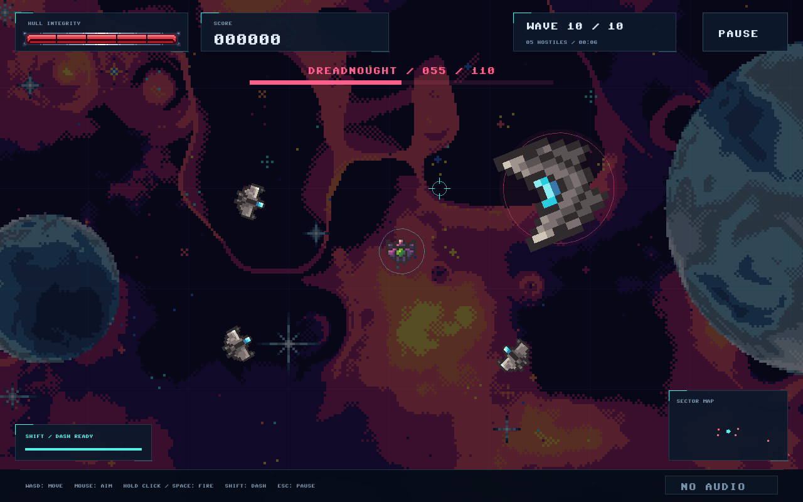

# Starfall lecturer walkthrough

Starfall is a C++17/SDL2 single-player arena shooter with a complete ten-wave campaign and local score history. The design goal is a playable game whose rules, presentation, lifetime management, and persistence can be followed in ordinary classes. The project uses composition rather than a general-purpose engine or an inheritance hierarchy.

Start with the [ownership and frame diagrams](ARCHITECTURE.md). The [developer guide](DEVELOPER.md) gives the full source map, prerequisites, commands, resource workflow, and failure behavior. No course-specific topic list or lecturer approval was supplied; the examples below describe the code that exists.

## What comes from the reference

| Contribution | Origin |
| --- | --- |
| Ship/projectile atlases, four background images, hull frame/fill, pixel font, shooting FLAC | Unchanged selected resources from the pinned game-course reference |
| Ten-wave campaign, hostile roles/behavior, dash, pickups, kill chain, score bonuses and final victory rules | Starfall simulation |
| Welcome/help/pause/end flow, pilot names, local top-ten scores and safe save retry | Starfall application and persistence |
| Atlas role assignments/scales, Dreadnought command ring, five-slot hull division, dimming and geometric indicators | Starfall presentation choices |
| Non-shot event effects | Starfall generation, loaded into owned mixer chunks |
| Window/input/drawing/audio/font/image facilities | SDL2 and its pinned companion libraries, with separate notices |

The Dreadnought reuses ship cell `(3,1)` at a larger scale; it is not a dedicated boss supplied by the reference. Its rules and supporting wave are Starfall's design. [COMBAT.md](COMBAT.md) records exact cells and hull clipping. The font identifies Devin Cook; other original resource creators have not been independently verified. The user attested permission covering the assets; exact terms/source remain forthcoming. See [credits](CREDITS.md), the [reference notice](../resources/reference/NOTICE.md), and the [manifest](../third_party/RESOURCE-MANIFEST.md). Starfall's MIT code license does not license imported assets.

## Follow the program

1. [main.cpp](../src/main.cpp), `launchGame`, parses options, constructs Game, and reports startup errors. Game initializes a window, renderer, visual resources, audio, and scores. Resources follow the executable; scores use the current-user preference folder or explicit `--data-dir`.
2. [Game.cpp](../src/app/Game.cpp), `execute`, drains SDL events, samples held input, advances active gameplay in fixed steps, draws, and calls SDL_RenderPresent. Screens.cpp contains Game's drawing methods. A shared layout already exists when input arrives.
3. [Run.cpp](../src/simulation/Run.cpp), `update`, changes the SDL-independent simulation. It processes timers, player, spawning, hostiles, shots, pickups, particles, cleanup, then wave completion. The application observes its const state and routes each step's events to Sound.
4. [Screens.cpp](../src/app/Screens.cpp), `gameplay`, reads positions, HUD statistics and results. Draw renders sprites/font/backgrounds through its owned VisualResources. Rendering cannot change the Run through its view.
5. [Scores.cpp](../src/persistence/Scores.cpp), `submit`, is called only by an explicit Save action for a completed, unsubmitted Run. It returns a retained rank, successful outside-top-ten result, or retryable error. Leaving a screen never silently submits a result.

## C++ examples to show in the editor

| Concept | Source example | Reason for the choice |
| --- | --- | --- |
| Classes and composition | [Game.hpp](../src/app/Game.hpp): Run member and unique_ptr Draw/Sound/Scores | Each owner has one clear responsibility; no engine framework is needed to connect them |
| Const observation and encapsulation | [Run.hpp](../src/simulation/Run.hpp): private `state_`, public `view()` | Rules own mutation; screen code can read the state without gaining a setter |
| Containers and algorithms | Run entity/event vectors; Scores `stable_sort` and `find_if`; Run `remove_if` cleanup | Collections grow/shrink with play; explicit algorithms express ranking, tie order and expiry |
| Deterministic state | [Run.cpp](../src/simulation/Run.cpp): `start(seed)` and mt19937 | Reset plus a known seed/input sequence makes difficult scenarios repeatable in a given environment |
| Automatic resource lifetime (RAII) | [VisualResources.hpp](../src/presentation/VisualResources.hpp): unique_ptr deleters and library guard; [Sound.cpp](../src/audio/Sound.cpp): `release` | Release handles before their libraries/renderer, including failure partway through startup |
| C++17 features used directly | [Rules.hpp](../src/simulation/Rules.hpp) inline constexpr values; filesystem paths; [Screens.cpp](../src/app/Screens.cpp) structured binding in `button` | Named shared rules, platform path handling, and readable access to rectangle fields |

For example, the actual observation interface is:

```cpp
const RunState& view() const noexcept { return state_; }
```

The returned reference is borrowed and read-only through this interface. It reflects later updates; it is not an immutable snapshot. Start/update can invalidate references into the entity vectors. Tests use a friend fixture defined in test support for controlled setup; normal callers have no public mutation setters.

VisualResources declares its library guard before its textures/fonts. C++ destroys members in reverse declaration order, so the handles disappear before image/font shutdown. Draw's cached text textures disappear before its VisualResources member. Game resets Draw and Sound before destroying SDL renderer/window handles. Sound first stops channels borrowing its chunks, then frees chunks and closes audio. This is a concrete reason to discuss ownership rather than just allocation.

## Four algorithms worth explaining

**Fixed-step time.** `Game::advance` adds at most 0.1 seconds from a display frame to an accumulator and repeatedly removes `Rules::FixedStep`, 1/120 second. A frame can contain zero or several gameplay updates. Speeds are world units per second; timers are seconds. Game consumes events after each update so several steps do not lose earlier sounds. Paused/menu screens skip Run advancement; screen changes reset the accumulator. UI animation still advances. This bounds catch-up after a long stall rather than simulating unlimited missed wall time.

**Swept projectile collision.** `segmentHitsCircle` checks the whole segment from the old shot position to the new one. It projects the target center onto that segment, clamps the fraction to its endpoints, and compares squared distance with squared radius. For a shot traveling from `(0,0)` to `(100,0)`, a target at `(50,3)` with radius 5 is hit even though the final shot position is far away. A stationary segment tests overlap. This prevents fast shots skipping a target between updates; it is not a general physics engine.

**Layout before input.** `screenLayout` provides the same logical rectangles used by drawing and hit testing. `changeScreen` refreshes layout immediately, so Enter can start and a following mouse click can pause before any intervening render. SDL already transforms queued mouse events into the 1280x800 logical canvas; only raw mouse-state sampling needs an explicit conversion. One conversion preserves hit alignment after resizing and letterboxing.

**Write before replacement.** `Scores::submit` prepares a copied candidate, retains stable ties, writes/flushes/closes a temporary file, replaces the destination, then publishes memory. Failed writing or replacement leaves the previous entries intact and allows retry. Windows uses MoveFileExW with replacement/write-through flags. This invariant protects the prior leaderboard during ordinary write errors; it does not promise immunity to every power failure or simultaneous writer.

The final-wave invariant is equally useful to show: destroying the Dreadnought leaves the Run active while supports remain. Only zero queued and live hostiles in wave ten produces victory. A repair cannot reverse a defeat earlier in the same update. These rules are tested through observable results.

## Repeatable demonstration

Use the source root for these commands. Build and generate the controlled captures through the existing test groupings:

```powershell
powershell.exe -NoProfile -ExecutionPolicy Bypass -File scripts/Build.ps1 -Toolchain GCC -Test -BuildDirectory build/lecturer-gcc -StageDirectory build/lecturer-stage
```

The [developer guide](DEVELOPER.md#build-test-and-stage) also gives the MSVC route. CTest sets dummy video/audio drivers for application flow and passes the legacy fixture path explicitly. Scenarios use unique isolated score directories under the build, run from an unrelated working directory, and restore altered resource fixtures. They do not read or write a player's normal leaderboard. The production executable has no demo or invulnerability option.

For the live part, start the staged game with a separate absolute demo save path:

```powershell
$demoScores = Join-Path (Get-Location).Path 'build/lecturer-live-scores'
.\build\lecturer-stage\Starfall.exe --data-dir $demoScores
```

Keep this path when reopening to demonstrate persistence. An existing demo folder retains its fictional scores; choose another new folder when an empty leaderboard is desired.

| Time | Show | Explain |
| --- | --- | --- |
| 0-1 min | Welcome -> How to Play -> Back -> Start Mission | Complete navigation, shared layouts, mouse or keyboard controls |
| 1-2 min | Move with WASD/arrows; aim separately; hold click/Space; Shift dash | Independent movement/aim, pink friendly/cyan hostile shots, dash recharge and brief protection |
| 2-3 min | Escape/P pause -> manual -> return -> resume | No gameplay time/damage while paused; focus loss also pauses |
| 3-4 min | Dash/overdrive and pickup captures | Cyan repair, gold overdrive and real paired-shot/dash updates without waiting for a random pickup |
| 4-5 min | Final-wave captures, boss gone with supports remaining, then victory | Real collision-driven durability and whole-wave victory invariant |
| 5-6 min | Natural defeat/name entry/Save/Leaderboard, or controlled result captures | Explicit submission once, retained rank, reopening the same isolated history |
| 6-9 min | Open Run::view, Game::advance, segmentHitsCircle, Scores::submit | Connect the visible game to composition, const access, timing, collision and persistence |

A short live run need not reach a pickup or wave ten. Use the controlled frames below when those moments do not occur; label them test scenarios rather than human-completed gameplay. For a natural end, allow defeat, enter a fictional name, Save, open Leaderboard, close and reopen using the same demo path. If time is short, show the existing save/reopen assertions and captures instead.

### Controlled viewing sequence

After the command above, open `build/lecturer-gcc/qa/navigation`. These files are produced by [ApplicationScenarios](../tests/application_tests.cpp); setup is external to production, followed by real update/event/render/save operations.

| Capture | Point to demonstrate |
| --- | --- |
| `01-welcome.bmp`, `02-gameplay.bmp` | Normal opening and active combat |
| `03-paused.bmp`, `04-controls.bmp` | Pause/manual flow |
| `11-flight-direction-0.bmp` through `-3.bmp` | Up/right/down/left center-pivot sprites and shot direction |
| `12-dash-overdrive.bmp` | Both pickup symbols, real dash recharge and paired overdrive shots |
| `17-hostiles-and-hud.bmp`, `16-hull-0.bmp` through `-5.bmp` | Distinct hostile cells, populated HUD/map/offscreen feedback, full and empty hull slots |
| `18-final-wave.bmp`, `19-dreadnought-half-hull.bmp` | Real scheduler creates boss plus four supports; 55 real collisions reduce boss from 110 to 55 |
| `20-supports-remain.bmp`, `21-whole-wave-victory.bmp` | Boss destruction alone is insufficient; final support opens victory with unchanged bonuses |
| `05-defeat.bmp`, `06-leaderboard.bmp`, `07-victory.bmp` | Completed results and a populated saved leaderboard |
| `09-legacy-leaderboard.bmp`, `10-save-retry.bmp` | Old-format data, replacement failure preserving entries, retry and fresh application reopening |

The final-wave fixture repositions scheduled hostiles for clear images and injects test shots that pass through real collision processing. The full-campaign focused scenario separately defeats all 131 hostiles through projectile collisions with an invulnerable test pilot. Neither is a human difficulty playtest. Actual 800x500 menu frames, camera extremes, resource failures and audio warnings are also retained in this QA directory. Published [gameplay](screenshots/gameplay.png) and [Dreadnought](screenshots/dreadnought.png) previews are converted actual captures.



## What the evidence establishes

Both Windows compiler routes pass focused gameplay/persistence and full application flow. The checks cover collision/progression, pause/navigation, resource decoding and failures, dummy audio, legacy score compatibility, safe replacement/retry, and completed-result submission. Current inspected captures cover all screens, sprite directions, hull states, map/HUD and the final encounter.

Real speaker output, real-monitor fullscreen/resize appearance/input, and human difficulty balance remain unverified. Dummy audio proves decoding/mixing; software captures prove the inspected output, not physical display behavior. Final clean archive/extraction validation is the portable-release step. Exact reference-asset permission terms/source remain forthcoming. The [validation record](VALIDATION.md) distinguishes current overhaul evidence from the historical procedural-game baseline.
