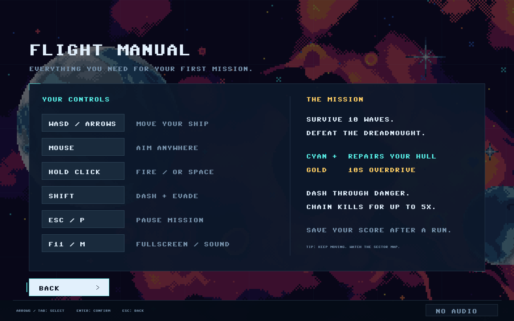
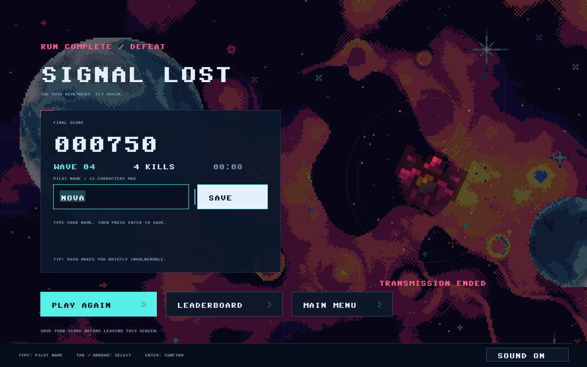

# Starfall player guide

Survive ten waves and clear the final wave, including the Dreadnought. Empty hull ends a run in defeat. Use the [user guide](USER.md) for launch, display, sound, and recovery instructions.

## Controls and menus

| Input | Action |
| --- | --- |
| WASD or arrow keys | Move in the arena |
| Mouse | Aim independently of movement |
| Hold left mouse button or Space | Fire continuously |
| Shift | Dash in your movement direction, or your aim direction while stationary |
| Escape or P; Pause button | Pause or resume |
| F11 | Switch fullscreen/windowed |
| M; sound button | Toggle sound; use the button during name entry |
| Tab/Up/Down, then Enter | Select and activate menu controls |
| Shift+Tab | Select the previous menu control |

The welcome screen lets you start, read the manual, inspect the leaderboard, or quit. **How to Play** is also available while paused and returns to that pause menu. Leaderboard visits return to the screen that opened them. Switching to another window pauses active combat.

## Read the HUD

- **Hull:** five equal segments at the top left, filled from left to right inside the imported frame. A segment is lost when an enemy ship or hostile shot damages you. Brief protection after damage prevents overlapping attacks from immediately removing every segment.
- **Score and multiplier:** points earned in this run, with the current kill-chain multiplier when active.
- **Wave, hostiles, and time:** your progress through the ten waves, remaining enemies including those queued to arrive, and active run time.
- **Dash:** the lower-left indicator shows whether Shift is ready. Recharge takes 2.6 seconds.
- **Overdrive and kill chain:** temporary weapon time and your continuing sequence of kills.
- **Sector map and edge indicators:** find enemies outside the current camera view. The camera follows the ship but stops at the arena boundary.
- **Dreadnought durability:** a separate bar and remaining/maximum hull count appear during the final encounter. The boss begins with 110 hull.

## Move, evade, and collect

Keep moving while aiming at enemies. Diagonal movement has the same overall speed as straight movement. The arena bounds stop the ship; the sector map helps locate threats when the camera reaches an edge.

Dash is a short movement burst with brief damage protection, followed by its recharge. It is useful for escaping overlapping shots or passing a nearby threat. Holding Shift cannot restart the cooldown immediately.

**Cyan repairs** restore one hull segment up to the maximum of five. **Gold overdrive** gives ten seconds of faster paired shots. Pickups expire, so decide whether collecting one is worth moving toward danger. Neither pickup is a permanent upgrade.

## Know the hostiles

| Hostile | Appearance and behavior | Base kill score |
| --- | --- | --- |
| Scout | Compact gray ship with a cyan cockpit; pursues the player | 100 |
| Gunner | Forked gray ship with a copper core; maneuvers and fires at the player | 200 |
| Tank | Broad gray/green ship; slower, with more durability | 350 |
| Dreadnought | Much larger cyan-core ship inside a pulsing command ring; spread attacks | 5,000 |

Enemies arrive away from the player, with announcements and short breaks between waves. Friendly shots are pink, hostile shots are cyan, and overdrive adds gold feedback to paired friendly shots. In wave ten, the Dreadnought arrives with four supporting hostiles: destroying the boss alone does not win until the whole wave is clear.

## Build a score

Kills within four seconds of one another continue a **kill chain**. Every five continuing kills increases the multiplier, up to **5x**. Damage or four seconds without a kill ends the chain.

Clearing a wave awards **100 × its wave number**. Victory adds **5,000**, plus **250 for each hull segment remaining**. These rules are unchanged by the presentation overhaul, so old and new leaderboard scores retain the same meaning.

## Finish and submit

The end screen shows victory or defeat, final score, reached wave, kills, and elapsed time. Click the name field to select its contents, type a supported name, and press **Enter** or click **Save**. Names support twelve English letters, numbers, spaces, hyphens, or underscores; empty names use **PILOT**.

The local leaderboard retains ten entries in descending score order. Earlier entries stay ahead of newly submitted equal scores. Saving confirms your retained rank, or **Outside the Top 10** when the result was submitted but not retained. A saved run cannot submit twice; a separate run may legitimately have the same result.

**Save before Play Again or Main Menu.** Leaving an end screen or abandoning a run never submits automatically. When a save fails, keep the screen open, correct the folder/file problem, and retry. See [save and upgrade guidance](SAVES.md) for details.

The game remains playable without audio.
